## Build · break · respawn

<code>zenith16f@github:~$ whoami</code>

  

  
  
  

## Operating principles

<pre><code>ROLE        = Game dev &amp; full-stack engineer
LOCATION    = remote
STATUS      = Building in public
STACK       = C · C# · TypeScript · Godot · VHDL
SHOP        = zenithflare05.gumroad.com</code></pre>

Building useful things and learning in public.

## Uptime in motion

  

## Service signals

  

  

## Infrastructure shipped

<pre><code>zenith16f@github:~$ ls -l repos/</code></pre>

| repo | description |
|------|-------------|
| [minimalist-portfolio-harvard-cv](https://github.com/zenith16f/minimalist-portfolio-harvard-cv) | Dual-mode Astro portfolio · web + Harvard CV from a single codebase |
| [SmallProjects](https://github.com/zenith16f/SmallProjects) | Personal projects built from scratch — Tetris, invitation app, and more |
| [SchoolProjects](https://github.com/zenith16f/SchoolProjects) | Complete projects from CS degree at ESCOM · IPN |
| [SchoolCodes](https://github.com/zenith16f/SchoolCodes) | Coursework archive · algorithms, systems, digital design |
| [Learning](https://github.com/zenith16f/Learning) | Language sandbox · C · C# · Python · Rust |

## Digital releases

<pre><code>zenith16f@github:~$ ls ~/gumroad/</code></pre>

| product | format | price |
|---------|--------|-------|
| [From Vacuum Tubes to AI: Operating Systems History](https://zenithflare05.gumroad.com/l/OS) | Bilingual ES/EN | Free |

  

## Platform toolkit

<pre><code>zenith16f@github:~$ toolbox --list</code></pre>

## Keep it moving

<pre><code>zenith16f@github:~$ contact --list</code></pre>

<code>zenith16f@github:~$ exit</code> · thanks for stopping by

